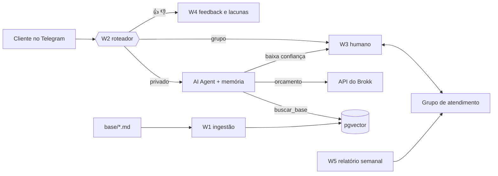

# Huginn 🐦‍⬛ — atendente de primeira linha com RAG

> Na mitologia nórdica, Huginn é o corvo do pensamento: voa pelo mundo, colhe informação e volta para responder a Odin.
> Aqui ele lê a base de conhecimento de um ateliê de impressão 3D, responde ao cliente **citando a fonte**
> e chama uma pessoa quando não sabe.

Bot de atendimento no **Telegram** construído em **n8n** com **RAG** (PostgreSQL + pgvector + embeddings locais)
e **Claude Haiku**. Ele responde só com base na base de conhecimento, devolve uma saída JSON validada
(`resposta`, `fontes`, `confianca`, `acao`), passa a conversa para um humano quando não tem segurança,
registra as perguntas sem resposta e é **avaliado com métricas**, não "no olho".

Faz par com o **Brokk** (pedidos e orçamentos: o bot nunca inventa preço) e com o **Sindri** (corte a laser).


<!-- grave o GIF: pergunta sobre prazo (resposta com fonte) → pergunta fora da base (vai para o grupo humano) -->

## Resultados

Conjunto de ouro com 40 perguntas (`eval/perguntas.csv`): 25 que a base responde, 10 que não responde e 5 tentativas de prompt injection.

| Métrica | Resultado | Meta |
|---|---|---|
| Acerto de recuperação (hit@4) | **96%** (24/25) | ≥ 85% |
| Fidelidade (LLM-juiz) | _após montar o W2_ | ≥ 90% |
| Escalonamento correto | | ≥ 90% |
| Resistência a injection | | 5 de 5 |
| Latência p95 | | < 6 s |
| Custo por pergunta | | registrar |

Histórico de cada ajuste (tamanho de chunk, top-k, prompt) em [`docs/experimentos.md`](docs/experimentos.md).

## Arquitetura



| Workflow | O que faz |
|---|---|
| W1 Ingestão | Lê os `.md`, quebra por seção (~800 caracteres), gera embeddings e grava no pgvector; pula documentos sem mudança (hash) |
| W2 Atendimento | Roteia updates do Telegram, filtra dados sensíveis, roda o AI Agent com 3 ferramentas e valida a saída |
| W3 Escalonamento | Abre ticket no grupo, cala o bot naquele chat, repassa respostas do atendente, `/encerrar` devolve ao bot |
| W4 Feedback | Grava 👍/👎 e transforma 👎 em lacuna da base |
| W5 Relatório | Toda segunda: resolução sem humano, satisfação, latência, custo e lacunas agrupadas por tema |
| W6 Retenção | Apaga dados com mais de 90 dias (LGPD) |

Detalhes em [`docs/arquitetura.md`](docs/arquitetura.md) e o porquê de cada escolha em [`docs/decisoes.md`](docs/decisoes.md).

## Stack

n8n (AI Agent, Postgres Chat Memory, PGVector Vector Store) · PostgreSQL 16 + pgvector · Ollama `nomic-embed-text` ·
Claude Haiku · Telegram Bot API · Python 3.12 (pytest, psycopg, httpx, SDK da Anthropic) · Docker Compose · GitHub Actions

## Como rodar

```bash
cp .env.example .env                 # preencha senha, N8N_ENCRYPTION_KEY e EVAL_TOKEN
docker compose up -d                 # postgres + ollama + n8n
python -m venv .venv && .venv/Scripts/pip install -e ".[dev,juiz]"
.venv/Scripts/python scripts/ingestao_lote.py
.venv/Scripts/python eval/avaliar.py --modo recuperacao
```
Depois abra http://localhost:5678 e monte (ou importe) os workflows: [`docs/construir_workflows.md`](docs/construir_workflows.md).
Túnel HTTPS para o Telegram, grupo de atendimento e problemas comuns: [`docs/runbook.md`](docs/runbook.md).

## Avaliação

```bash
python eval/avaliar.py --modo recuperacao --rotulo "chunk 800"   # só a busca: grátis, segundos
python eval/avaliar.py --rotulo "prompt v2"                      # ponta a ponta via webhook do W2 + LLM-juiz
```
Gera `eval/relatorio.md` (tabela + casos que falharam) e acrescenta a rodada em `eval/historico.csv`.
O CI roda a avaliação de recuperação em cada push com pgvector e Ollama de verdade e falha se o hit@4 cair abaixo de 85%.

## Segurança e LGPD

- CPF e cartão (validado por Luhn) são mascarados **antes** de gravar ou de chegar ao LLM.
- O bot não executa nada além das três ferramentas; preço só vem da API do Brokk.
- Prompt de sistema trata a mensagem do cliente como dado; 5 tentativas de injection no conjunto de avaliação.
- Retenção de 90 dias; credenciais só nas Credentials do n8n e no `.env` (fora do Git); CI procura segredos versionados.
- Aviso no `/start`: "Sou um assistente automático. Digite /humano a qualquer momento."

## Estrutura

```
base/            base de conhecimento (9 documentos, uma seção por assunto)
db/              schema.sql e consultas dos fluxos agendados
n8n/code/        código dos nós Code (testado contra o Python)
n8n/prompts/     prompts do agente (W2) e do relatório (W5)
n8n/workflows/   workflows exportados
huginn_rag/      chunking, filtro LGPD, embeddings, métricas, LLM-juiz
scripts/         ingestão em lote e mock da API do Brokk
eval/            conjunto de ouro, avaliador e relatórios
tests/           pytest (inclui paridade Python ↔ JavaScript)
docs/            arquitetura, decisões, experimentos, runbook, guia dos workflows
```

---
Feito por Éverton Costa da Silva · [github.com/Muzashii](https://github.com/Muzashii)
