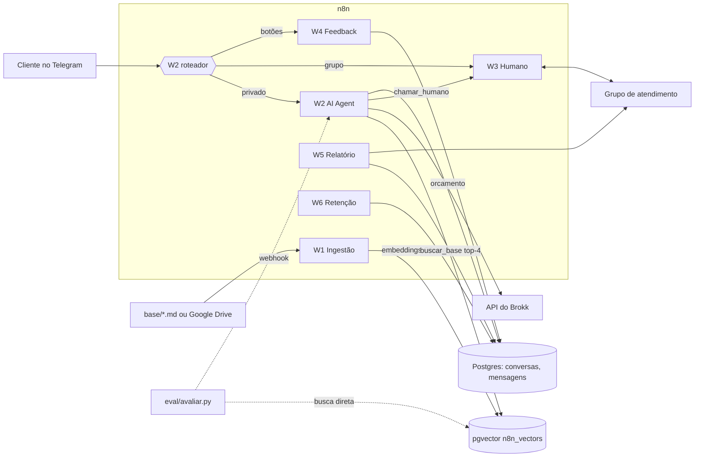

# Arquitetura



## Caminho de uma mensagem

1. **Telegram Trigger** recebe o update; o **roteador** decide: privado, grupo ou botão.
2. **Filtro de entrada** mascara CPF/cartão, corta mensagens longas, detecta `/start`, `/humano`, e marca suspeita de injection.
3. **Upsert conversa** — se a conversa está em modo `humano`, a mensagem vai para o grupo e o bot não fala.
4. **AI Agent** (Claude Haiku) com memória das últimas 10 mensagens decide usar `buscar_base` (top-4 chunks no pgvector),
   `orcamento` (API do Brokk) ou `chamar_humano`.
5. **Validar saída** garante `{resposta, fontes, confianca, acao}`; na dúvida, `chamar_humano`.
6. Grava em `mensagens` (com latência e tokens) e responde com 👍/👎, ou escala para o W3.

## Contrato da resposta

```json
{
  "resposta": "Peças em resina ficam prontas em 3 a 5 dias úteis, mais o frete.",
  "fontes": ["01_prazos_e_entrega.md#prazo-de-producao-em-resina"],
  "confianca": "alta",
  "acao": "responder"
}
```
`fontes` usa o formato `arquivo.md#slug-da-secao`, o mesmo gravado em `metadata.fonte` de cada chunk,
o que permite medir hit@k e entregar ao LLM-juiz o texto exato que foi citado.

## Componentes Python

| Arquivo | Papel |
|---|---|
| `huginn_rag/chunking.py` | seções e chunks (espelho de `n8n/code/w1_chunking.js`) |
| `huginn_rag/lgpd.py` | filtro de entrada (espelho de `n8n/code/w2_filtro_entrada.js`) |
| `huginn_rag/embeddings.py` | cliente Ollama/OpenAI |
| `huginn_rag/metricas.py` | hit@k, escalonamento, injection, percentis, custo |
| `huginn_rag/juiz.py` | LLM-juiz com saída estruturada |
| `scripts/ingestao_lote.py` | recarga da base sem o n8n |
| `eval/avaliar.py` | avaliação (modos `recuperacao` e `completo`) |
